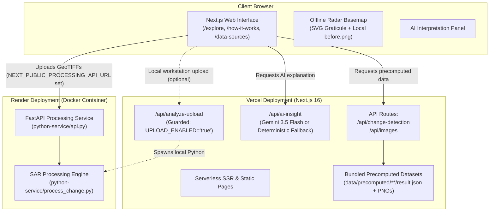

# TerraPulse

> **TerraPulse** (formerly *Dancing with the SARs*) — A scientific geospatial platform that detects, quantifies, and visualizes Earth surface changes using Synthetic Aperture Radar (SAR) backscatter comparison.

- **Live Demo**: `TODO(team): Vercel URL`

---

## What It Does

TerraPulse performs bi-temporal change detection using Synthetic Aperture Radar (SAR) satellite imagery. Because SAR sensors transmit active microwave signals that penetrate clouds, haze, smoke, and nocturnal darkness, the platform provides uninterrupted environmental monitoring across weather conditions that obstruct optical satellites.

The platform provides two primary workflows:
1. **Quick Demo**: Instant visualization of 10 fully precomputed demonstration case studies without requiring Python or external API keys.
2. **Upload Your Own**: Interactive analysis of paired custom GeoTIFF scenes (`image_a.tif` and `image_b.tif`) processed through a dedicated Python service (`python-service/process_change.py`).

### Four Analysis Modes

- **Flood Inundation (`flood`)**: Identifies newly submerged land areas where specular reflection of microwave pulses off calm water causes a pronounced drop in radar backscatter relative to rough terrestrial soil or vegetation.
- **River Bank Erosion & Accretion (`river-erosion`)**: Analyzes channel morphology along dynamic rivers by detecting land-to-water erosion and water-to-land accretion within a spatial corridor buffered around the active river channel. Computes multi-year net land change and annualized erosion rates.
- **Forest Canopy Loss (`deforestation`)**: Flags canopy loss and vegetation clearance by identifying sharp decreases in volumetric radar backscatter (typically evaluated using cross-polarized VH microwave scattering).
- **Surface Water Dynamics (`surface-water`)**: Quantifies seasonal surface water expansion, wetland fluctuations, and reservoir depletion between two observation epochs, distinguishing persistent water, new water, and receded water bodies.

---

## How Open Data from Space Agencies Made This Possible

TerraPulse relies on open-access Earth observation data provided by space agencies:

- **European Space Agency (ESA) / Copernicus Programme**:
  - The computational pipeline uses Level-1 Ground Range Detected (GRD) products from the **Copernicus Sentinel-1** C-band SAR constellation (operating at 5.405 GHz in Interferometric Wide / IW swath mode with ~10 m spatial resolution).
  - Both co-polarized ($\text{VV}$) and cross-polarized ($\text{VH}$) channels are accessed via **Google Earth Engine** (`COPERNICUS/S1_GRD`), the **Copernicus Data Space Ecosystem**, and the **Alaska Satellite Facility (ASF) DAAC**.
- **NASA Open Science & Reference Datasets**:
  - Selected case studies in the project metadata reference public NASA Earth science outputs as external comparison benchmarks, specifically the **NASA/JPL OPERA DSWx-S1** (Dynamic Surface Water extent from Sentinel-1) flood extent prototype and **NASA Earth Observatory** disaster analysis reports.
  - *Note on data provenance*: The automated computational pipeline in `python-service/process_change.py` ingests Copernicus Sentinel-1 C-band SAR scenes as its primary input. It does not ingest direct NASA satellite rasters (such as raw Landsat or MODIS rasters) in the core change algorithm.

---

## Method and Processing Pipeline

The change detection pipeline is implemented in Python (`python-service/process_change.py`) using `rasterio`, `numpy`, `scipy`, and `Pillow`.

### 1. Input Handling & Pre-Processing
- **Windowed Block Reading**: Rasters are read in blocks using `rasterio.open().block_windows()` to minimize memory overhead during processing.
- **Decimation for Large Scenes**: If total scene pixels exceed 100,000,000 (`MAX_PIXELS_DECIMATE = 100_000_000`), the raster is read at a decimated resolution using bilinear resampling (`Resampling.bilinear`). The affine transform is scaled accordingly (`eff_transform`) to ensure all subsequent area computations remain physically accurate.
- **Nodata and Invalid Masking**: Dataset `nodata` values and non-finite numbers (`inf`, `-inf`, `nan`) are mapped to `np.nan` and excluded from all statistical and area calculations.
- **Band & Polarization Handling**:
  - If a file contains two bands, Band 1 is mapped to $\text{VV}$ and Band 2 to $\text{VH}$. Single-band files are treated as $\text{VV}$.
  - The deforestation mode defaults to cross-polarization ($\text{VH}$) for superior volume scattering sensitivity. If only single-band $\text{VV}$ data is supplied for deforestation, the pipeline issues a warning.
- **Reprojection and Grid Alignment**: If Image B differs from Image A in Coordinate Reference System (CRS), affine transform, or array dimensions, Image B is reprojected onto Image A's grid using bilinear interpolation.

### 2. Scale Detection (`to_db`)
- The pipeline automatically detects whether the input imagery is in raw linear power or decibel (dB) scale:
  - If values contain negative numbers within roughly $-60\text{ dB}$ to $+25\text{ dB}$ (or minimum $< 0$ and maximum $\le 150$), it retains the values as already in decibels.
  - If values are non-negative linear power, it converts them to decibels using $10 \cdot \log_{10}(\text{arr})$.

### 3. Speckle Filtering
- **Applied Filter**: A spatial $5 \times 5$ median filter (`scipy.ndimage.median_filter(..., size=5)`) is applied to valid pixels of both input images in dB scale to suppress high-frequency radar speckle noise before thresholding.
- **Filter Status**: Dedicated SAR-specific adaptive speckle filters (such as Lee, Frost, Refined Lee, or Gamma MAP) are **not** implemented in the code; filtering is performed exclusively using spatial median filtering.

### 4. Mode Logic and Default Thresholds

- **Water Mask Thresholds**:
  - $\text{VV}$ default water threshold: `-16.0 dB` (`DEFAULT_WATER_THRESHOLD_VV`)
  - $\text{VH}$ default water threshold: `-22.0 dB` (`DEFAULT_WATER_THRESHOLD_VH`)
  - Water is identified where pixel backscatter falls below the threshold.
  - Connected water patches with fewer than 20 pixels (`min_pixels = 20`) are pruned using `scipy.ndimage.label` to remove isolated noise.
- **Water Transition Matrix**:
  - Class `0`: Land in both epochs ($0 \rightarrow 0$)
  - Class `1`: Persistent water ($1 \rightarrow 1$)
  - Class `2`: New water ($0 \rightarrow 1$)
  - Class `3`: Lost / receded water ($1 \rightarrow 0$)
- **Mode-Specific Rules**:
  - **`flood`**:
    - Flooded Area (`floodedAreaKm2`): Class 2 (new water).
    - Persistent Water (`persistentWaterKm2`): Class 1.
    - Receded Water (`recededWaterKm2`): Class 3.
  - **`surface-water`**:
    - Metric calculation: $\text{waterDeltaKm2} = \text{water}_B - \text{water}_A$.
    - Affected Area (`affectedAreaKm2`): sum of Class 2 (new water) and Class 3 (lost water).
  - **`river-erosion`**:
    - The persistent river channel (Class 1) is dilated by 5 pixels (`river_buffer = 5`) using `scipy.ndimage.binary_dilation`.
    - Erosion (`erosionAreaKm2`): Connected components of new water (Class 2) intersecting the dilated river channel.
    - Accretion (`accretionAreaKm2`): Connected components of lost water (Class 3) intersecting the dilated river channel.
    - Net Land Change: $\text{Accretion} - \text{Erosion}$.
    - Annualized Erosion Rate: $\text{erosionKm2} / (\text{days} / 365.25)$ in $\text{km}^2/\text{year}$.
    - Any new or lost water patches outside the channel buffer are classified separately as `other_new_water` and `other_lost_water`.
  - **`deforestation`**:
    - Default loss threshold: `-3.0 dB` (`loss_threshold_db = -3.0`).
    - Canopy loss condition: $\Delta\text{dB} = \text{data}_B - \text{data}_A \le -3.0\text{ dB}$.
    - Pruned with `min_pixels = 20` connected component filtering.
  - **`change`** (generic legacy mode):
    - Default threshold: `3.0 dB`. Flags absolute backscatter difference $|\text{data}_B - \text{data}_A| \ge 3.0\text{ dB}$.

### 5. Geodesic Pixel Size & Area Calculation
- Pixel area is computed dynamically by `calculate_pixel_area_km2`:
  - **Geographic CRS (e.g., EPSG:4326)**: Width in meters is computed as $(dx \cdot 111,320 \cdot \cos(\text{center\_latitude}))$ and height as $(dy \cdot 110,574)$. Area in $\text{km}^2$ is $(\text{width\_m} \cdot \text{height\_m}) / 1,000,000$. Degree resolution is never treated directly as linear meters.
  - **Projected CRS**: Dimensions are multiplied by `crs.linear_units_factor` and divided by $1,000,000$.

### 6. Pipeline Outputs
- `before.png` and `after.png`: 8-bit single-channel grayscale PNGs clipped between $-25\text{ dB}$ and $0\text{ dB}$ and scaled to $[0, 255]$ (downscaled to a maximum width of 1,600 pixels).
- `change-map.png`: Transparent RGBA PNG reprojected to EPSG:4326 (maximum width 2,000 pixels) using categorical palette mapping:
  - Transparent: No change / unclassified (`[0, 0, 0, 0]`)
  - Neutral `#7D8A92` at 50% opacity: Persistent water (`[125, 138, 146, 128]`)
  - Rust `#A8462E` at 100% opacity: Flagged hazard (flood, erosion, forest loss) (`[168, 70, 46, 255]`)
  - Teal `#2C5C61` at 100% opacity: Opposite change (receded water, river accretion) (`[44, 92, 97, 255]`)
  - Subdued overlays (`[44, 92, 97, 75]` and `[168, 70, 46, 75]`): Non-channel water transitions.
- `result.json`: Machine-readable metadata containing total area, affected area, percentage changed, confidence and signal strength metrics, bounding box coordinates, observation dates, and mode-specific parameters.

---

## Limitations and Validation Status

### Scientific Disclaimer
- **Backscatter-Change Indicators**: The results generated by this platform are automated indicators of microwave backscatter change. They are not legal land surveys, cadastral records, or definitive in-situ hydrological observations.
- **No Agency Endorsement**: TerraPulse is an independent software project developed for the NASA International Space Apps Challenge. **No validation, certification, or official endorsement exists from NASA, ESA, or any other space agency.**
- **Ground-Truth Validation Status**: `TODO(team): Document formal ground-truth accuracy validation results, error matrices, and Cohen's kappa metrics against certified in-situ datasets.`
  - The validation conducted to date within this repository consists of informal visual and comparative verification against publicly accessible reference materials (such as Copernicus Emergency Management Service rapid mapping activations, published literature, and optical imagery).

### Case-Specific Limitations (Ready Cases)

As documented in `data/case-studies/seed.json` and `lib/case-studies.ts`:

1. **Sylhet Flood 2022**: Specular reflection on smooth saturated soil or standing sheet water can mimic open water backscatter drops.
2. **Jamuna River Erosion (2019–2024)**: Accurate erosion assessment requires dry-season low-flow comparisons to control for water stage variations; SAR water masks serve as a proxy for bankline migration.
3. **Amazon Deforestation (2021–2023)**: Soil moisture spikes following tropical rainfall modulate surface dielectric properties and backscatter; cross-polarized $\text{VH}$ data is required to isolate volume scattering losses from moisture shifts.
4. **Tanguar Haor Seasonal Water (2023)**: Dense emergent vegetation and aquatic reeds can obscure open water surfaces from C-band microwaves.
5. **Eastern Bangladesh Flash Flood 2024 (Feni)**: C-band $\text{VV}$ water detection can miss urban flooding (due to corner-reflector double bounce) and inundated vegetation; comparison pairs must use identical relative orbits and passes.
6. **Pakistan Monsoon Floods 2022 (Sindh)**: The monitored demonstration area is a localized spatial sub-window and does not represent the full geographical scale of the regional flood event.
7. **Rio Grande do Sul Floods 2024 (Porto Alegre)**: Urban inundation is poorly detected by backscatter decreases; wind-roughened open water increases surface roughness and can appear misleadingly bright.
8. **Padma River Bank Erosion (Naria)**: Requires comparisons between matching seasons across multi-year intervals to minimize water-level discrepancies; channel-edge water detection remains an indirect proxy for bank collapse.
9. **Kutupalong Refugee Camp Forest Loss (2017)**: Steep hilly terrain induces radar layover, foreshortening, and shadow distortions; rapid settlement construction (introducing metallic roofs and rough structures) modulates backscatter simultaneously with tree clearance.
10. **Hakaluki Haor Seasonal Wetland (2023)**: Wet-season agricultural crops and emergent marsh flora can mask water surfaces from radar detection.

---

## Case Studies

The following table lists all 10 **READY** case studies currently bundled with precomputed outputs (`data/precomputed/<id>/result.json`):

| Module | Case Study Title & Location | Observation Dates (`result.json`) | Duration | Reference Links (`seed.json`) |
| :--- | :--- | :--- | :--- | :--- |
| **Flood** | **Sylhet Flood 2022**<br>Sylhet Division, Surma River Basin, Bangladesh | 2022-05-01 → 2022-06-21 | 51 days | [Copernicus Data Space Ecosystem](https://dataspace.copernicus.eu/) |
| **River Erosion** | **Jamuna River Erosion 2019 to 2024**<br>Jamuna River Corridor, Bangladesh | 2019-02-15 → 2024-02-15 | 1,826 days (5.0 yrs) | [Copernicus Data Space Ecosystem](https://dataspace.copernicus.eu/) |
| **Deforestation** | **Amazon Deforestation**<br>Rondônia, Brazilian Amazon, Brazil | 2021-01-01 → 2023-01-01 | 730 days (2.0 yrs) | [Copernicus Data Space Ecosystem](https://dataspace.copernicus.eu/) |
| **Surface Water** | **Tanguar Haor Seasonal Water**<br>Sunamganj, Sylhet Basin, Bangladesh | 2023-02-15 → 2023-08-15 | 181 days | [Copernicus Data Space Ecosystem](https://dataspace.copernicus.eu/) |
| **Flood** | **Eastern Bangladesh Flash Flood 2024 (Feni)**<br>Feni, Noakhali, Cumilla, Bangladesh | 2024-08-05 → 2024-08-21 | 16 days | [Disasters Charter Activation 905](https://download.disasterscharter.org/web/guest/activations/-/article/flood-in-bangladesh-activation-905-), [NASA/JPL OPERA DSWx-S1 Flood Prototype](https://gis.earthdata.nasa.gov/gis05/rest/services/DISASTERS_202408_FLOOD_BANGLADESH/2423_opera_dswx_s1/ImageServer/info/metadata) |
| **Flood** | **Pakistan Monsoon Floods 2022 (Sindh, Lake Manchar)**<br>Sindh province, Indus basin, Pakistan | 2022-07-20 → 2022-08-30 | 41 days | [NHESS 2023 Sentinel-1 Study](https://nhess.copernicus.org/articles/23/3305/2023/nhess-23-3305-2023.html), [NASA Earth Observatory](https://science.nasa.gov/?p=1063149), [UNOSAT / HDX](https://data.humdata.org) |
| **Flood** | **Rio Grande do Sul Floods 2024 (Porto Alegre)**<br>Porto Alegre and Lake Guaiba, Brazil | 2024-04-14 → 2024-05-08 | 24 days | [Copernicus EMS EMSR720](https://emergency.copernicus.eu/news/rio-grande-do-sul-flooding-brazil-april-to-june-2024/), [NASA Earth Observatory](https://science.nasa.gov/earth/earth-observatory/floods-engulf-porto-alegre-152795/) |
| **River Erosion** | **Padma River Bank Erosion (Naria, Shariatpur)**<br>Padma River near Naria, Bangladesh | 2017-01-15 → 2024-01-15 | 2,556 days (7.0 yrs) | [Billah (2018) Quaestiones Geographicae](https://qg.web.amu.edu.pl/qg/archives/2018/quageo-2018-0027.pdf), [Bangladesh River Research Institute](https://rri.portal.gov.bd/site/page/c3267bf0-5448-4729-b7fe-e8c1c30d346d), [MIST Repository](https://dspace.mist.ac.bd/items/10f740a7-320e-465b-aaf7-52aaeff179c7) |
| **Deforestation** | **Kutupalong Refugee Camp Forest Loss 2017**<br>Ukhia/Teknaf, Cox's Bazar, Bangladesh | 2017-01-01 → 2018-01-01 | 365 days (1.0 yr) | [Remote Sensing 11(17):2047](https://www.mdpi.com/2072-4292/11/17/2047), [Al Jazeera / New Arab](https://newarab.com/analysis/bangladeshi-forests-stripped-rohingya-refugees-battle-survive) |
| **Surface Water** | **Hakaluki Haor Seasonal Wetland**<br>Moulvibazar and Sylhet, Bangladesh | 2023-02-15 → 2023-08-01 | 167 days | [Banglapedia](https://en.banglapedia.org/index.php/Hakaluki_Haor), [UNDP Assessment Report](https://info.undp.org/docs/pdc/Documents/BGD/9.%20Assessment%20Report_District%20Level%20Planning%2029%20August%202018%20copy.pdf) |

*(Additional candidate studies registered in `data/case-studies/seed.json` with status `pending-data` will be activated once corresponding precomputed result bundles are generated).*

---

## System Architecture



### Key Architectural Subsystems
- **Offline Radar Basemap**:
  - The default basemap is an offline-first canvas on `#F1F0EC` displaying the AOI's SAR `before.png` as an `ImageOverlay`.
  - Renders a geographical coordinate graticule with latitude/longitude labels in `IBM Plex Mono` using native Leaflet polylines and `L.divIcon` (zero external CDN plugins).
  - Automatically activates if `navigator.onLine === false` or when 3 tile errors occur within 5 seconds on OpenStreetMap, displaying a quiet notice `"Offline: showing radar basemap"`.
- **Deterministic AI Fallback**:
  - Located in `lib/ai-insight-fallback.ts`.
  - When the Google Gemini API key is not configured or network requests fail/time out, the narrative panel deterministically generates structured remote-sensing explanations directly from computed area and change percentages, tagging the output with a `"Deterministic Offline Narrative"` badge.

---

## Running Locally

### 1. Prerequisites
- **Node.js**: Version `20.9.0` or later (as defined in `package.json` engines and `.nvmrc`).
- **npm**: Version `9.x` or later.
- **Python** *(optional, only needed for local processing or running the FastAPI service)*: Python 3.11 or 3.12 recommended for pre-built GDAL/rasterio wheels.

### 2. Node.js Setup
```bash
# 1. Clone the repository
git clone https://github.com/Ajoy12roy/dancing-with-sars.git
cd dancing-with-sars

# 2. Install dependencies
npm install

# 3. Start development server
npm run dev
```
Open [http://localhost:3000](http://localhost:3000) to view the application with all 10 precomputed demo cases available immediately.

### 3. Python Service Setup (Optional)
To run the live processing FastAPI service locally:
```bash
# 1. Navigate to python-service and create virtual environment
cd python-service
python -m venv .venv

# 2. Activate virtual environment
# Windows:
.venv\Scripts\activate
# macOS/Linux:
source .venv/bin/activate

# 3. Install requirements
pip install -r requirements.txt

# 4. Start the FastAPI server
uvicorn api:app --host 127.0.0.1 --port 8000 --reload
```

### 4. Environment Variables

The table below lists all variables supported in `.env.example`:

| Variable Name | Purpose & Behavior |
| :--- | :--- |
| `GEMINI_API_KEY` | Google Gemini API key used by `/api/ai-insight` for generative narrative insights. If unset or network fails, the platform automatically falls back to deterministic rule-based narrative generation. |
| `GOOGLE_API_KEY` | Alternative Google API key name recognized as a secondary fallback for Gemini. |
| `NEXT_PUBLIC_APP_URL` | Canonical public URL of the web deployment (e.g. `https://terrapulse.vercel.app`). |
| `NEXT_PUBLIC_PROCESSING_API_URL` | Base URL of the separate Python FastAPI processing service (e.g. `http://localhost:8000` or a Render service URL). If left unset, the frontend upload interface displays a clear notice: *"Live processing is not configured; precomputed areas still work."* |
| `UPLOAD_ENABLED` | Feature flag guarding the Next.js local subprocess route (`/api/analyze-upload`). If set to `"true"`, allows Next.js to spawn local Python processes on your workstation. If unset or `"false"`, the endpoint returns HTTP 503 to safely disable subprocess execution on serverless hosting platforms like Vercel. |
| `PYTHON_BIN` | Custom executable path or command name for Python (e.g. `python`, `python3`, or an absolute path) used when `UPLOAD_ENABLED="true"`. Defaults to searching system PATH and `python-service/.venv`. |

---

## Deployment

### Vercel (Next.js Frontend & API Routes)
- **Deployment Model**: Deploys as a standard Next.js project.
- **Configuration**:
  - No `vercel.json` is required or present in the repository.
  - Precomputed assets in `data/precomputed/` and case studies in `data/case-studies/` are included in serverless trace bundles via `outputFileTracingIncludes` in `next.config.ts`.
  - `.vercelignore` excludes `python-service/`, heavy GeoTIFF directories (`data/samples/`, `data/sample-uploads/`), and development scripts.
  - Leave `UPLOAD_ENABLED` unset (or `false`) in Vercel project settings so that serverless functions do not attempt to invoke Python subprocesses.

### Render (Python FastAPI Service)
- **Deployment Model**: Deploys as a Docker Web Service from the repository.
- **Configuration**:
  - **Root Directory**: `python-service`
  - **Dockerfile**: `python-service/Dockerfile` (uses `python:3.12-slim` and exposes the configured `$PORT`).
  - **Environment Variables**:
    - `ALLOWED_ORIGINS`: Comma-separated list of allowed frontend domains (e.g. `https://terrapulse.vercel.app,http://localhost:3000`).
    - `PORT`: Set by Render automatically (defaults to `7860` in Dockerfile if unassigned).
    - `MAX_UPLOAD_MB`: Maximum upload file size in megabytes (default `60`).
    - `RATE_LIMIT_PER_10MIN`: Requests allowed per IP in a 10-minute window (default `10`).

---

## Accessibility and Design System

The application adheres to the custom design guidelines specified in [`DESIGN_SYSTEM.md`](DESIGN_SYSTEM.md):

- **Typography**:
  - Headings: `Source Serif 4`
  - Body text: `Public Sans`
  - Data metrics, coordinates, and statistics: `IBM Plex Mono`
  - All fonts are self-hosted via `next/font/local` in `app/fonts/` with zero third-party font CDN requests.
- **Palette and Contrast**:
  - Neutral paper background (`#F1F0EC` light, `#141618` dark).
  - Primary text ink (`#1D2023` light, `#EDEBE6` dark).
  - Single primary data accent: Survey Teal (`#2C5C61`).
  - Alert accent: Annotation Rust (`#A8462E`) reserved strictly for actual hazard conditions and negative loss values.
  - Rules and borders: 1px hairline (`#C7C4BC`).
  - Text tokens use solid colors without Tailwind opacity modifiers.
- **Theme Mechanism**: Light and dark themes are applied via `data-theme="light|dark"` attributes on `<html>`, with CSS custom properties driving styling across components.
- **Structural Constraints**: Border radii are restricted to $0\text{--}2\text{px}$, with no box-shadows, glow filters, or non-semantic gradients in UI panels.
- **Semantic HTML & ARIA**:
  - Structured using semantic elements (`<header>`, `<nav>`, `<main>`, `<section>`, `<footer>`, `<table>`).
  - Interactive tab lists, disclosure elements, and buttons utilize descriptive `role` and `aria-*` attributes (`role="tab"`, `aria-selected`, `aria-label`, `aria-hidden`).
- **Motion Reduction**:
  - Restrained animations are implemented with Framer Motion.
  - Continuous animations (such as the navbar satellite orbit) automatically stop when `prefers-reduced-motion: reduce` is detected in user system preferences.
- *Compliance note*: Formal WCAG 2.1 compliance certification has not been conducted.

---

## Development Timeline

`TODO(team): describe what was built before and during the event`

---

## Attribution and Credits

### Satellite Data & Spatial Data
- **Copernicus Sentinel Data**: Contains modified Copernicus Sentinel data [2017–2024], operated by the European Space Agency (ESA) and accessed via Google Earth Engine and the Alaska Satellite Facility (ASF) DAAC under the European Commission's Copernicus Open Access Policy.
- **OpenStreetMap**: Interactive Street map tiles and reference coastline data are provided by © [OpenStreetMap](https://www.openstreetmap.org/copyright) contributors, licensed under the Open Data Commons Open Database License (ODbL).

### Third-Party Software Libraries & Licenses

#### Frontend Dependencies (`package.json`)
- `@google/generative-ai` — Apache License 2.0
- `framer-motion` — MIT License
- `leaflet` — BSD 2-Clause License
- `lucide-react` — ISC License
- `next` — MIT License
- `react` & `react-dom` — MIT License
- `react-leaflet` — Hippocratic License 2.1 / MIT
- `recharts` — MIT License
- `tailwindcss` & `@tailwindcss/postcss` — MIT License
- `typescript` — Apache License 2.0
- `eslint` & `eslint-config-next` — MIT License

#### Backend Dependencies (`python-service/requirements.txt`)
- `rasterio` — BSD 3-Clause License
- `numpy` — BSD 3-Clause License
- `scipy` — BSD 3-Clause License
- `pillow` — HPND License / Historical Permission Notice and Disclaimer
- `affine` — BSD 3-Clause License
- `fastapi` — MIT License
- `uvicorn` — BSD 3-Clause License
- `python-multipart` — Apache License 2.0

#### Typography (`app/fonts/`)
- `Source Serif 4` — SIL Open Font License 1.1 (designed by Frank Grießhammer, Adobe)
- `Public Sans` — SIL Open Font License 1.1 / CC0 (United States Web Design System)
- `IBM Plex Mono` — SIL Open Font License 1.1 (Mike Abbink, Bold Monday, IBM)

---

## License

This project is open-source software licensed under the terms of the [MIT License](LICENSE).
